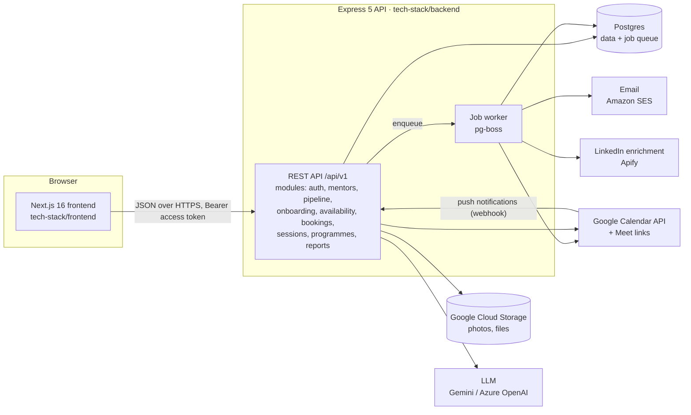

# 02 · Architecture

## System overview

- **One API, one database.** Postgres holds the data and the job queue, so we
  don't run Redis or a separate broker in v1.
- **Slow or unreliable work runs in jobs:** calendar sync, emails, reminders,
  LinkedIn enrichment and AI note drafts. The API returns straight away
  (`202 Accepted` where the result comes later) and the UI shows a status.

## Stack

| Layer | Choice | Where it comes from |
| --- | --- | --- |
| Frontend | Next.js 16 App Router, React 19, TypeScript, Tailwind v4, shadcn/ui (Base UI), TanStack Query v5, react-hook-form + Zod | Frontend boilerplate |
| Backend | Express 5, TypeScript (ESM), Zod validation, OpenAPI 3.1 docs, pino logging, Vitest | Backend boilerplate |
| Database | Postgres 16. **Prisma for migrations only; Kysely for every query** | Backend boilerplate |
| Auth | Self-issued JWT (jose, HS256): short-lived access token in memory, refresh token in an httpOnly cookie; argon2id passwords | Backend boilerplate (`src/core/auth`) |
| Jobs | **pg-boss** (Postgres-backed queue, retries, scheduled jobs) | New; recommended |
| Calendar | Google Calendar API v3 (OAuth per mentor), Meet links via `conferenceData` | New |
| Email | Amazon SES (env vars already in the boilerplate config) | Boilerplate config; client code is new |
| Files | Google Cloud Storage with signed URLs (pattern from Founders OS) | Boilerplate config; adapter is new |
| AI | Gemini or Azure OpenAI for session-note drafts (env vars already in config) | Boilerplate config; client code is new |
| Drag and drop | `@dnd-kit` for the pipeline board | New dependency |

### What the boilerplate does and doesn't give us

The backend boilerplate is a **foundation**, not a working app:

- **Provided:** app setup, error handling, response envelope, cursor
  pagination, role guards with row scoping, audit log, OpenAPI docs, health
  endpoints, Docker and Cloud Build deploy files, and test setup.
- **Not provided (we build it):** login, refresh and logout endpoints, the
  `RefreshSession` table, a users module, any feature module, a job queue,
  and clients for email, storage and AI.

The frontend boilerplate is further along: app shell with sidebar, role-based
navigation, auth context and token refresh, API client with the same envelope,
query-key factory, data tables, forms in dialogs, toasts, charts and theming.

## Backend modules

Each module is a vertical slice copied from `src/modules/_template/`:
`routes → controller → service → repository`, plus `schema` (Zod), `docs`
(OpenAPI), `types` and tests. Slices never import from each other; shared
logic goes in `src/core` or `src/shared`.

| Module | Responsibility |
| --- | --- |
| `auth` | Login, refresh (rotating, revocable sessions), logout, invite acceptance, password reset |
| `users` | User accounts and roles (admin-only management) |
| `programmes` | Programmes or cohorts; the scoping unit for managers |
| `mentors` | Mentor profiles, expertise tags, directory search, CSV import |
| `pipeline` | Pipeline stages, stage changes, owner, activity timeline |
| `onboarding` | Invite links, step progress, agreement acceptance, approval |
| `availability` | Weekly rules, date exceptions, booking settings, slot computation |
| `calendar` | Google OAuth connect and disconnect, free/busy, event create, update and delete, push-notification webhook |
| `bookings` | Book, accept, decline, reschedule, cancel; conflict checks |
| `sessions` | Session notes, action items, feedback, no-shows, AI draft |
| `notifications` | Email templates and sending (called from jobs) |
| `reports` | Programme and mentor metrics, CSV export |

### Jobs (pg-boss)

| Job | Trigger | What it does |
| --- | --- | --- |
| `email.send` | Any notification | Render a template and send via SES; retried 3× with backoff |
| `booking.reminder` | Scheduled at booking time for T−24h and T−1h | Email both sides; skipped if the booking was cancelled |
| `calendar.sync-event` | Booking created, rescheduled or cancelled | Create, update or delete the Google event with a Meet link |
| `calendar.refresh-watch` | Daily | Renew Google push-notification channels before they expire |
| `calendar.pull-changes` | Google webhook | Fetch changed events; free up slots or flag conflicts |
| `mentor.enrich-linkedin` | LinkedIn URL saved | Fetch photo and headline, re-host the photo to GCS, record status |
| `session.draft-note` | Mentor requests an AI draft | Turn a transcript into a structured note for the mentor to edit |
| `session.request-feedback` | 1 hour after a session ends | Ask both sides for feedback |

The worker can run in the same process as the API at first, and move to its
own process (same image, different start command) when load grows.

## Frontend structure

Feature slices under `src/features/<feature>/` (services, TanStack Query hooks,
Zod schemas, components, barrel `index.ts`), routes under `src/app/`:

| Route group | Who | Screens |
| --- | --- | --- |
| `(app)/admin/*` | Admin, programme manager | Dashboard, mentors directory, pipeline board, mentor detail, programmes, bookings, reports, settings |
| `(app)/mentor/*` | Mentor | Onboarding wizard, profile, availability, upcoming sessions, session notes |
| `(app)/mentee/*` | Mentee | Find a mentor, mentor profile and booking, my sessions, action items |
| `(public)/book/[mentorSlug]` | Signed-in mentee via a shared link | Book directly from a link |
| `(auth)/*` | Everyone | Login, accept invite, reset password |

Role theming and navigation come from the boilerplate's typed nav config and
`<AppShell workspace="...">`.

## Deployment

- **Backend:** the boilerplate's `Dockerfile` (runs `prisma migrate deploy` on
  start) or `cloudbuild.yaml` (App Engine, secrets from Secret Manager). Run the
  pg-boss worker as a second service from the same image.
- **Frontend:** Vercel or Cloud Run. `NEXT_PUBLIC_API_BASE_URL` points at the API.
- **Database:** Cloud SQL for Postgres 16, daily backups, point-in-time recovery.
- **Secrets:** Secret Manager only. Never a key file in the repo (see
  [10-security.md](10-security.md)).

## Key decisions and why

| Decision | Why |
| --- | --- |
| Postgres, not MongoDB (Founders OS uses Mongo) | Bookings need transactions and an exclusion constraint against double booking; the CRM needs relational queries and reporting |
| pg-boss, not Redis/BullMQ | One less service; jobs commit in the same transaction as the booking, so a reminder is never scheduled for a booking that rolled back |
| Build booking in-house, not embed Calendly | Mentors and mentees live in our system; we need programme rules, limits, notes and reporting tied to each booking |
| Google Calendar first | Most mentors use Google Workspace or Gmail; Outlook later behind the same `calendar` module interface |
