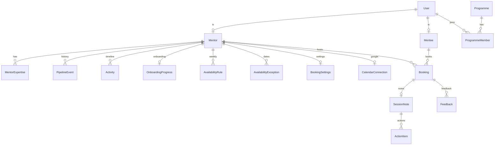

# 03 · Data model

Postgres 16. Tables are defined in `tech-stack/backend/prisma/schema.prisma` and
created with Prisma Migrate; **queries use Kysely**, never Prisma Client. Follow
the boilerplate's rules:

- Every default lives in the database (`gen_random_uuid()`, `now()`).
- Repositories set `updatedAt` themselves.
- After changing the schema: `npm run db:migrate -- --name <change>`, which also
  regenerates the Kysely types.

## Entity overview



## Roles

Extend the boilerplate's enum:

```prisma
enum Role {
  ADMIN     // Mesa programme operations: sees everything
  MANAGER   // programme manager: scoped to their programmes
  MENTOR
  MENTEE
}
```

The boilerplate's `scopeFor()` gives `ADMIN` everything, `MANAGER` rows in their
department, `USER` their own rows. Update it so that:

- **`MANAGER`** is scoped by programme, via `ProgrammeMember`; the access-token
  claim `departmentId` becomes `programmeIds`.
- **`MENTOR` and `MENTEE`** see their own rows, plus what a booking shares
  between them.

## Prisma models (draft)

```prisma
model User {
  id           String   @id @default(dbgenerated("gen_random_uuid()")) @db.Uuid
  email        String   @unique
  passwordHash String?  // null until an invite is accepted
  role         Role
  name         String
  timezone     String   @default("Asia/Kolkata") // IANA name
  isActive     Boolean  @default(true)
  createdAt    DateTime @default(dbgenerated("now()")) @db.Timestamptz
  updatedAt    DateTime @default(dbgenerated("now()")) @db.Timestamptz
}

model RefreshSession {          // rotating, revocable refresh tokens
  id         String    @id @default(dbgenerated("gen_random_uuid()")) @db.Uuid
  userId     String    @db.Uuid
  familyId   String    @db.Uuid  // revoke the whole family on reuse
  tokenHash  String    @unique   // sha-256 of the jti, never the token
  expiresAt  DateTime  @db.Timestamptz
  revokedAt  DateTime? @db.Timestamptz
  createdAt  DateTime  @default(dbgenerated("now()")) @db.Timestamptz
  @@index([userId])
}

model Programme {
  id        String   @id @default(dbgenerated("gen_random_uuid()")) @db.Uuid
  name      String
  startsOn  DateTime? @db.Date
  endsOn    DateTime? @db.Date
  createdAt DateTime @default(dbgenerated("now()")) @db.Timestamptz
}

model ProgrammeMember {
  programmeId String @db.Uuid
  userId      String @db.Uuid
  role        Role                 // MANAGER, MENTOR or MENTEE within this programme
  @@id([programmeId, userId])
}

enum MentorStage {
  PROSPECT
  CONTACTED
  INTERESTED
  ONBOARDING
  ACTIVE
  PAUSED
  ALUMNI
  DECLINED
}

model Mentor {
  id             String      @id @default(dbgenerated("gen_random_uuid()")) @db.Uuid
  userId         String?     @unique @db.Uuid  // null while still a prospect
  slug           String      @unique           // for /book/[slug]
  name           String
  email          String      @unique
  phone          String?
  headline       String?                       // "VP Product, Acme"
  company        String?
  bio            String?
  photoUrl       String?                       // GCS object path, served signed
  linkedinUrl    String?
  linkedinStatus String      @default("not_provided") // pending | completed | failed:<reason>
  city           String?
  languages      String[]
  stage          MentorStage @default(PROSPECT)
  ownerId        String?     @db.Uuid          // team member managing the relationship
  source         String?                       // referral, event, import...
  customFields   Json        @default("{}")
  ratingAvg      Decimal?    @db.Decimal(3, 2) // maintained by the sessions module
  sessionsHeld   Int         @default(0)
  createdAt      DateTime    @default(dbgenerated("now()")) @db.Timestamptz
  updatedAt      DateTime    @default(dbgenerated("now()")) @db.Timestamptz
  @@index([stage])
  @@index([ownerId])
}

model ExpertiseTag {
  id    String @id @default(dbgenerated("gen_random_uuid()")) @db.Uuid
  name  String @unique        // "Fundraising", "B2B sales", "Product"...
  group String?               // "Business", "Tech", "Industry"
}

model MentorExpertise {
  mentorId String @db.Uuid
  tagId    String @db.Uuid
  @@id([mentorId, tagId])
}

model PipelineEvent {          // every stage change, for history and funnel reports
  id        String      @id @default(dbgenerated("gen_random_uuid()")) @db.Uuid
  mentorId  String      @db.Uuid
  fromStage MentorStage?
  toStage   MentorStage
  actorId   String?     @db.Uuid
  reason    String?
  createdAt DateTime    @default(dbgenerated("now()")) @db.Timestamptz
  @@index([mentorId, createdAt])
}

model Activity {               // CRM timeline: notes, emails, calls, system events
  id        String   @id @default(dbgenerated("gen_random_uuid()")) @db.Uuid
  mentorId  String   @db.Uuid
  type      String   // note | email | call | meeting | system
  body      String?
  metadata  Json     @default("{}")
  actorId   String?  @db.Uuid
  createdAt DateTime @default(dbgenerated("now()")) @db.Timestamptz
  @@index([mentorId, createdAt])
}

model OnboardingProgress {
  mentorId          String    @id @db.Uuid
  inviteTokenHash   String?   @unique          // sha-256; the raw token is only in the email
  inviteExpiresAt   DateTime? @db.Timestamptz
  profileDoneAt     DateTime? @db.Timestamptz
  linkedinDoneAt    DateTime? @db.Timestamptz
  agreementVersion  String?
  agreementAt       DateTime? @db.Timestamptz
  calendarDoneAt    DateTime? @db.Timestamptz
  submittedAt       DateTime? @db.Timestamptz
  approvedAt        DateTime? @db.Timestamptz
  approvedBy        String?   @db.Uuid
  draft             Json      @default("{}")    // autosaved form answers
  updatedAt         DateTime  @default(dbgenerated("now()")) @db.Timestamptz
}

model Mentee {
  id        String   @id @default(dbgenerated("gen_random_uuid()")) @db.Uuid
  userId    String   @unique @db.Uuid
  startup   String?
  stage     String?   // idea, MVP, revenue...
  goals     String?
  createdAt DateTime @default(dbgenerated("now()")) @db.Timestamptz
}

model AvailabilityRule {       // weekly recurring hours, in the mentor's time zone
  id        String @id @default(dbgenerated("gen_random_uuid()")) @db.Uuid
  mentorId  String @db.Uuid
  weekday   Int    // 0 = Monday ... 6 = Sunday
  startTime String // "18:00" local
  endTime   String // "20:00" local
  @@index([mentorId])
}

model AvailabilityException {  // a day off, or extra hours on a date
  id        String   @id @default(dbgenerated("gen_random_uuid()")) @db.Uuid
  mentorId  String   @db.Uuid
  date      DateTime @db.Date
  startTime String?  // null with isAvailable=false means the whole day is off
  endTime   String?
  isAvailable Boolean
  @@index([mentorId, date])
}

model BookingSettings {
  mentorId           String  @id @db.Uuid
  durations          Int[]   @default([30])  // minutes offered: [30, 45, 60]
  bufferBefore       Int     @default(0)
  bufferAfter        Int     @default(15)
  minNoticeHours     Int     @default(24)
  maxDaysAhead       Int     @default(30)
  maxPerWeek         Int?
  requiresApproval   Boolean @default(false)
  cancelCutoffHours  Int     @default(12)
}

model CalendarConnection {     // Google OAuth per mentor; tokens encrypted at rest
  mentorId          String    @id @db.Uuid
  provider          String    @default("google")
  googleEmail       String
  refreshTokenEnc   Bytes                      // AES-256-GCM; key from Secret Manager
  calendarIds       String[]                   // calendars checked for busy time
  writeCalendarId   String                     // where events are created
  watchChannelId    String?
  watchResourceId   String?
  watchExpiresAt    DateTime? @db.Timestamptz
  syncToken         String?
  status            String    @default("ok")   // ok | revoked | error
  updatedAt         DateTime  @default(dbgenerated("now()")) @db.Timestamptz
}

enum BookingStatus {
  PENDING      // waiting for mentor approval
  CONFIRMED
  DECLINED
  CANCELLED
  COMPLETED
  NO_SHOW
}

model Booking {
  id             String        @id @default(dbgenerated("gen_random_uuid()")) @db.Uuid
  mentorId       String        @db.Uuid
  menteeId       String        @db.Uuid
  programmeId    String?       @db.Uuid
  startsAt       DateTime      @db.Timestamptz // always UTC
  endsAt         DateTime      @db.Timestamptz
  status         BookingStatus @default(CONFIRMED)
  agenda         String?
  meetUrl        String?
  googleEventId  String?
  cancelledBy    String?       @db.Uuid
  cancelReason   String?
  rescheduledFrom String?      @db.Uuid
  version        Int           @default(1)      // optimistic locking (StaleResourceError)
  createdAt      DateTime      @default(dbgenerated("now()")) @db.Timestamptz
  updatedAt      DateTime      @default(dbgenerated("now()")) @db.Timestamptz
  @@index([mentorId, startsAt])
  @@index([menteeId, startsAt])
}

model SessionNote {            // structure from the Founders OS check-in template
  bookingId       String   @id @db.Uuid
  outcome         String?
  problems        String?
  advice          String?
  privateNotes    String?  // mentor-only
  aiDrafted       Boolean  @default(false)
  sharedWithMentee Boolean @default(true)
  createdAt       DateTime @default(dbgenerated("now()")) @db.Timestamptz
  updatedAt       DateTime @default(dbgenerated("now()")) @db.Timestamptz
}

model ActionItem {
  id         String    @id @default(dbgenerated("gen_random_uuid()")) @db.Uuid
  bookingId  String    @db.Uuid
  title      String
  ownerId    String    @db.Uuid   // usually the mentee
  dueOn      DateTime? @db.Date
  doneAt     DateTime? @db.Timestamptz
  createdAt  DateTime  @default(dbgenerated("now()")) @db.Timestamptz
  @@index([ownerId, doneAt])
}

model Feedback {
  id         String   @id @default(dbgenerated("gen_random_uuid()")) @db.Uuid
  bookingId  String   @db.Uuid
  fromUserId String   @db.Uuid
  rating     Int      // 1-5, CHECK constraint in the migration
  comment    String?
  createdAt  DateTime @default(dbgenerated("now()")) @db.Timestamptz
  @@unique([bookingId, fromUserId])
}
```

Foreign keys are omitted above for readability; add `@relation`s with
`onDelete` rules in the real schema. `AuditLog` from the boilerplate stays as is
and records every write that matters (stage changes, approvals, cancellations).

## Constraints Prisma can't express

Add these by hand in the migration SQL (`prisma migrate dev --create-only`, then edit):

```sql
-- No two live bookings may overlap for the same mentor.
CREATE EXTENSION IF NOT EXISTS btree_gist;
ALTER TABLE "Booking"
  ADD CONSTRAINT booking_no_overlap
  EXCLUDE USING gist (
    "mentorId" WITH =,
    tstzrange("startsAt", "endsAt", '[)') WITH &&
  ) WHERE (status IN ('PENDING', 'CONFIRMED'));

ALTER TABLE "Booking"  ADD CONSTRAINT booking_time_order CHECK ("endsAt" > "startsAt");
ALTER TABLE "Feedback" ADD CONSTRAINT feedback_rating CHECK (rating BETWEEN 1 AND 5);
ALTER TABLE "AvailabilityRule" ADD CONSTRAINT weekday_range CHECK (weekday BETWEEN 0 AND 6);

-- Directory search on name, headline and company.
CREATE INDEX mentor_search ON "Mentor"
  USING gin (to_tsvector('simple', coalesce(name,'') || ' ' || coalesce(headline,'') || ' ' || coalesce(company,'')));
```

The exclusion constraint is the real guarantee against double booking: even
if two people book the same slot at the same moment, Postgres rejects the second
insert, and the repository turns it into a `409 SLOT_TAKEN` (the boilerplate's
`onUniqueViolation` pattern, extended to error code `23P01`).
