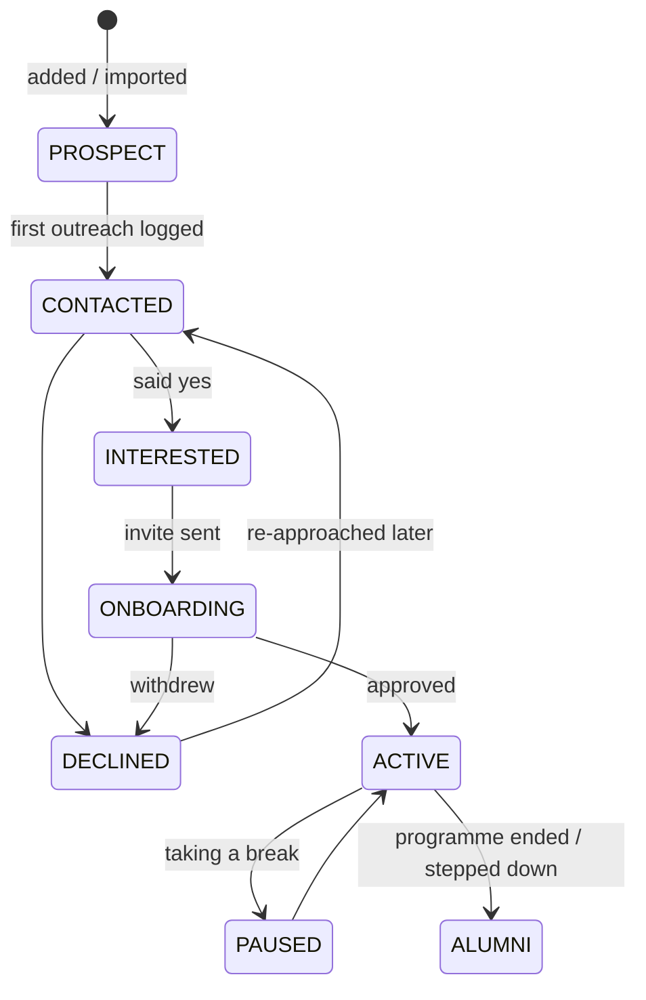
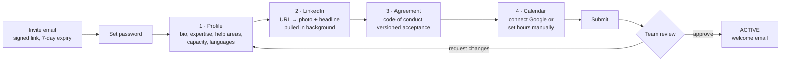

# 06 · Onboarding and CRM

## Mentor pipeline

- **Who can move cards:** admins and programme managers. Some moves happen
  automatically: sending an invite → `ONBOARDING`, approval → `ACTIVE`.
- **Every move** writes a `PipelineEvent` (for funnel reports and time-in-stage)
  and an `Activity` (for the timeline).
- **Only `ACTIVE` mentors** appear to mentees or accept bookings. Moving to
  `PAUSED` hides the mentor but keeps existing bookings; the UI warns about
  upcoming sessions.

## CRM screens (admin and programme manager)

| Screen | What it has |
| --- | --- |
| **Mentors table** | Boilerplate DataTable with server-side search, filters (stage, tags, owner, programme, city), sort, cursor pagination, CSV export |
| **Pipeline board** | Columns per stage with counts. Cards show photo, name, headline, owner and days in stage. Drag and drop with `@dnd-kit` updates optimistically, then rolls back on error |
| **Mentor detail** | Profile, stage, owner, tags, programmes, upcoming and past sessions, ratings, onboarding checklist, and the **activity timeline** with "add note / log call" |
| **Import** | Upload the existing sheet as CSV, map columns, preview, import. Duplicates are matched on email |

Tip from Founders OS: `@dnd-kit` is installed there but never used, so the
board is new work; no code to borrow.

## Onboarding flow (mentor)

- **Autosave:** the wizard saves to `PUT /onboarding/me/draft` as the mentor
  types (debounced), and keeps a local copy too, so nothing is lost on refresh.
  This is the pattern Founders OS's discovery form uses (`discoveryFormStore`).
- **Each step is its own route** (`/mentor/onboarding/profile`, `/linkedin`, …), so
  the browser's back button works and the team can link to a specific step.
- **LinkedIn enrichment** runs as a job (`mentor.enrich-linkedin`): fetch, then
  re-host the photo to GCS and store the status (`pending`, `completed`,
  `failed:<reason>`). The UI polls a few times, and if it fails, the mentor can
  upload a photo by hand. Never block onboarding on it.
- **Agreement:** store the version and the time accepted. A new version asks
  active mentors to accept again on next sign-in.
- **Reminders:** if a mentor is stuck on a step for 3 days, email them once,
  and show "stuck" on their pipeline card.

## Session notes

Based on the check-in template designed in Founders OS
(`exports/templates/Mesa_CheckIn_RAW_TEMPLATE.md`):

| Field | Visible to mentee | Notes |
| --- | --- | --- |
| Outcome | Yes (if shared) | One or two sentences |
| Problems discussed | Yes (if shared) | |
| Advice given | Yes (if shared) | |
| Action items | Yes | Each with an owner and due date; they appear on the owner's dashboard |
| Private notes | No | Mentor and programme team only |

**AI draft:** the mentor pastes a transcript or rough notes and gets a draft of
the fields above to edit. The draft is never saved as final without the mentor
pressing Save. Store `aiDrafted: true` so reports can tell AI-assisted notes
apart. Send only the text the mentor provides to the model, never other records.

## Notifications (v1: email only)

| Event | To |
| --- | --- |
| Invite sent | Mentor |
| Onboarding submitted | Owner (team member) |
| Approved / changes requested | Mentor |
| Stuck for 3 days | Mentor |
| Booking confirmed, reminders, cancelled, rescheduled | Mentor and mentee |
| Feedback request, note nudge | Per [05-booking.md](05-booking.md#reminders-and-follow-up) |

WhatsApp comes later. Founders OS has a Chatwoot + WhatsApp Cloud API setup
guide, but it's incomplete (parts 8–16 missing) and there's no code; treat it as
background reading, not a plan.
